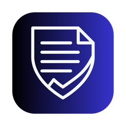
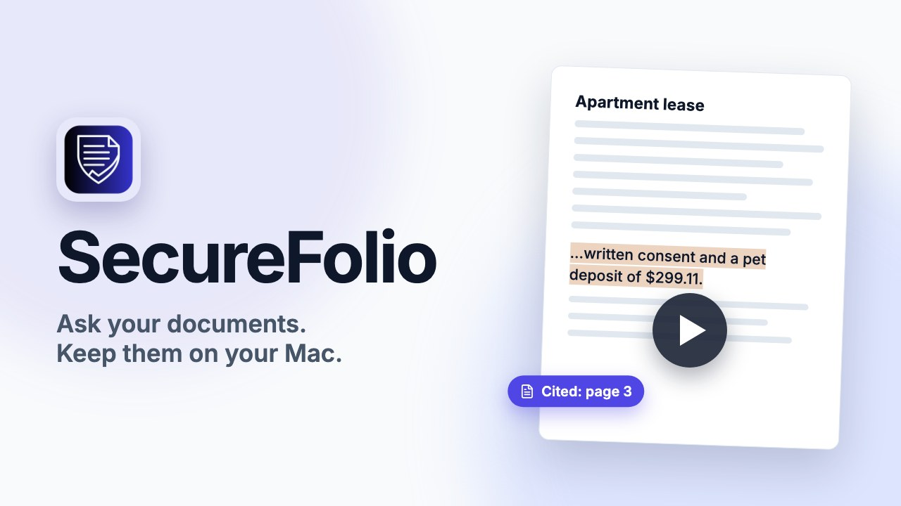
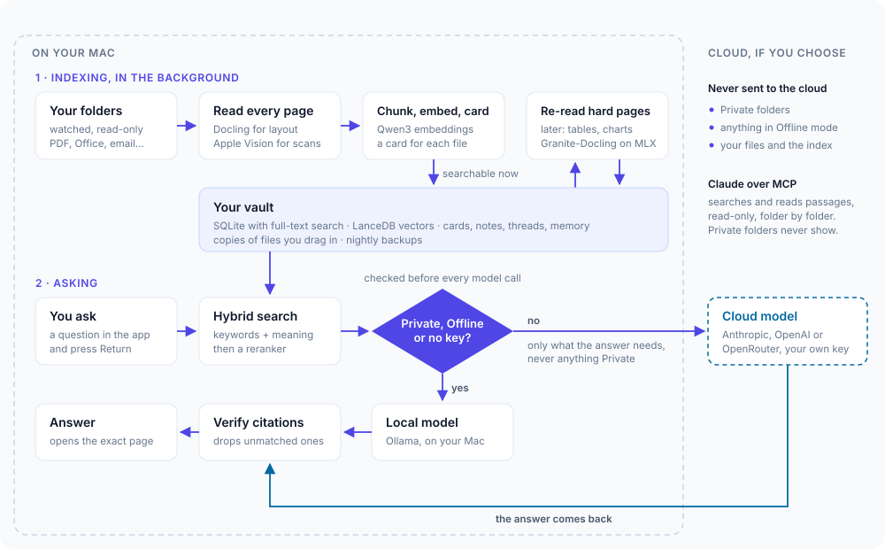

<p align="center">
  
</p>

<h1 align="center">SecureFolio</h1>

<p align="center">
  <strong>A private library of every document you own, on your Mac.</strong><br>
  Find any file or fact as you type. Ask a question and get an answer whose every citation opens the exact page.
</p>

<p align="center">
  <a href="LICENSE"></a>
  
  
</p>

<p align="center">
  <a href="https://youtu.be/yVMF5ZuwJko">
    
  </a>
  <br>
  <sub><a href="https://youtu.be/yVMF5ZuwJko">Watch the demo</a> (6:48): what it does, how it works inside, and a demo on a test library of made-up documents.</sub>
</p>

<p align="center">
  <a href="#what-it-does">What it does</a> ·
  <a href="#how-it-works">How it works</a> ·
  <a href="#privacy">Privacy</a> ·
  <a href="#build-and-install">Build and install</a> ·
  <a href="#use">Use</a> ·
  <a href="#develop">Develop</a>
</p>

---

Your contracts, statements, receipts, scans, slides and emails are spread across folders, and the one fact you need is usually on page 14 of something. SecureFolio watches the folders you choose and reads every page on your Mac, including scans, tables and charts. Then it lets you search by words or by meaning, or ask in plain English: "When does the lease renew?", "What did we pay the contractor in total?" Each answer cites its sources, and a click opens the document at the page with the passage highlighted.

It is built for privacy first. Your files, the index and everything SecureFolio learns are stored only on your Mac. Folders you mark **Private** never reach a cloud model or MCP, and **Offline mode** answers with a local model and makes no connection off the Mac at all. Claude Desktop and Claude Code can search your library too, through a read-only MCP server.

SecureFolio is a native macOS app for Apple Silicon. It is an early, single-user project: expect rough edges, and back up what matters. There is no prebuilt download: you build it from source, as [below](#build-and-install).

## What it does

**Find**

- **Search as you type**, by words and by meaning at once, and still exact for invoice numbers, amounts and names.
- **Quick search from anywhere** with Option-Space, and a command palette in the app with Command-K.
- **Filter the library** by folder, type, date and tag, then ask about just the documents shown.

**Ask**

- **Answers with citations.** Each citation opens its page, sheet, slide, email or lines, with the passage highlighted where it can be placed exactly.
- **Checked citations.** A citation that matches nothing the answer was given is dropped, and a sentence with no citation is marked as uncited. When the library doesn't hold the answer, SecureFolio says so instead of guessing.
- **Lists and totals,** such as "which contracts expire this year?", are worked out from every document in scope, and the answer names any document it couldn't check.
- **Comparisons** across the documents you pick, naming any that had nothing to say.
- **Your choice of model:** Anthropic, OpenAI or OpenRouter with your own key, or a local model through [Ollama](https://ollama.com). Without a key, search and local answers still work.

**Organize**

- **A card for every document:** its title, a summary, its type, and the dates, people, organizations and amounts in it, written by a local model by default. You can edit any card, and your edits are kept.
- **Collections, notes, threads and memory,** all editable. Memory holds what SecureFolio learns from your conversations, and you can delete any of it.
- **Nightly backups,** the last 7 kept, with restore from Settings.

**Connect**

- **MCP for Claude Desktop and Claude Code:** read-only tools to search the library, read a passage, open a document and list collections, with a switch for each folder.

### What it reads

| Format                            | Read on your Mac with              | A citation opens                        |
| --------------------------------- | ---------------------------------- | --------------------------------------- |
| PDF, with a text layer or scanned | Docling, with Apple Vision for OCR | the page, with the passage highlighted  |
| PNG, JPEG, HEIC and WEBP          | Docling, with Apple Vision for OCR | the image, with the passage highlighted |
| Word (DOCX)                       | Docling                            | the paragraph, table or heading         |
| PowerPoint (PPTX)                 | Docling                            | the slide                               |
| Excel (XLSX) and CSV              | its own reader, sheet by sheet     | the sheet and its rows                  |
| HTML, including saved web pages   | Docling                            | the place in the page                   |
| Email (`.eml`)                    | its own reader                     | the message and its lines               |
| Markdown and plain text           | its own reader                     | the lines                               |

Pages that are hard to read, such as weak tables, charts, crowded layouts or a bad hidden text layer, are read a second time from the page's image after the document is already searchable. With a local model installed, charts become tables and figures get a description. SecureFolio never changes, moves or deletes your files: they are read where they are.

## How it works

<p align="center">
  
</p>

**1. Indexing, in the background.** A worker process watches your folders and picks up new and changed files within seconds. It runs at low priority, only on power or above 20% battery.

1. **Read.** Docling works out each page's layout: headings, paragraphs, tables and pictures. Apple Vision reads the text of scans and photos.
2. **Chunk, embed and card.** Text is split into passages that remember exactly where they came from, and embedded with Qwen3-Embedding. A local model writes the document's card, or, for a Standard folder where you turn on Cloud organizing, the cloud model you chose.
3. **Store.** Everything goes into your vault, `~/Library/Application Support/SecureFolio`: one SQLite database with full-text search, and a LanceDB vector index beside it. The document is searchable from here on.
4. **Re-read hard pages, later.** A page with a weak table, a chart or a broken text layer is read again from its image, at lower priority, by Granite-Docling, a small vision model running on your Mac with MLX. The document is published again only if the second reading changed something; one that would lose a table, or words Apple Vision can see, is refused, and the first reading is kept.

**2. Asking.** When you ask a question, the backend's Ask agent runs a fixed sequence of steps:

1. **Prepare:** the policy decides where this conversation may go, before any model is called, and the conversation's summary and the memories that apply are loaded. Private material, Offline mode or no key: the local model on your Mac does the work. Otherwise the cloud model you chose does.
2. **Plan:** the model rewrites the question into a search, with any filters, and tells a lookup from a comparison or a list.
3. **Retrieve:** hybrid search, keyword (BM25) and vector results fused, then reranked by Qwen3-Reranker. If the best match is weak, it tries once more.
4. **Answer:** the model answers from the passages, citing each one. Every cloud call is checked against the policy again at the moment it's sent, from the sensitivity of everything in it. A cloud model receives only the question, the recent turns and summary of the conversation, the memories that apply, the passages and cards behind the answer, and on a retry the titles of near-miss documents; never anything Private.
5. **Verify:** citations that match nothing the model was given are dropped, uncited sentences are marked, and the turn is saved.

### The parts

| Part                                      | Language                   | What it does                                                                                             |
| ----------------------------------------- | -------------------------- | -------------------------------------------------------------------------------------------------------- |
| Backend (`backend/`, with `agent/` in it) | Python, FastAPI, LangGraph | Owns every record and rule. Serves the app's API and the MCP tools on 127.0.0.1, and runs the Ask agent. |
| Worker (`worker/`)                        | Python                     | Watches folders, reads, embeds and writes cards. Started and watched by the backend.                     |
| App (`app/`)                              | TypeScript, React          | The interface, inside the shell's window.                                                                |
| Shell (`desktop/src-tauri/`)              | Rust, Tauri 2              | The Mac app: the window, the menu bar, the global hotkey, and starting the backend.                      |
| MCP bridge (`desktop/mcp-bridge/`)        | Rust                       | A small stdio MCP server for Claude Desktop and Claude Code that forwards calls to the backend.          |
| Ollama (optional)                         |                            | Local models for Private and Offline answers, cards and figures.                                         |

[docs/ARCHITECTURE.md](docs/ARCHITECTURE.md) explains how the parts fit together and the rules the code keeps. [docs/TECH_STACK.md](docs/TECH_STACK.md) has the technical detail of each one.

## Privacy

These are SecureFolio's promises. The backend enforces them, whatever the app, the agent or an MCP client asks for, and the tests prove them.

- **Your files, the index, embeddings, OCR and memory are stored only on your Mac.** A cloud model receives only what a request needs: the question, the recent turns and summary of the conversation, the memories that apply, the passages and cards behind the answer, and on a retry the titles of near-miss documents. Nothing else leaves, except what you choose: excerpts for cards from folders where you turn on Cloud organizing, a page you ask a cloud model to read, the small test request when you check a key, and the evaluation's answers if you run it.
- **Private stays private.** Documents in a Private folder never reach a cloud model or MCP, in a question, a summary, a memory or a card. A conversation that has touched Private documents stays Private for good.
- **Offline mode** makes no network connection off the Mac, from any part of SecureFolio.
- **Your originals are never changed, moved or deleted.** Removing a document from the library never deletes a file.
- **Document text is data, never an instruction,** and nothing a model can call through SecureFolio changes anything.
- **Local only.** The app listens only on 127.0.0.1, with a new token on every launch. Cloud keys live in the Keychain. Background cloud work stops at the monthly spending cap you set.
- **No tracking.** SecureFolio sends no analytics, and turns off LangSmith tracing and Hugging Face telemetry in every process.

The vault is stored unencrypted, so turn on FileVault. Pages are read on your Mac; one goes to a cloud model only if you choose "Read this page with Cloud AI" on a Standard document, after seeing the cost.

## Requirements

- A Mac with Apple Silicon and macOS 13 or later. 16 GB of memory works; 48 GB lets the default local model, `gemma4:26b`, run.
- About 4 GB of disk for the search, OCR and page-reading models, downloaded on first run, plus Ollama's model if you want local answers.
- To build: [uv](https://docs.astral.sh/uv/), Node 22.12 or later, a stable Rust toolchain (`rustup`) and Xcode's command line tools.

## Build and install

```bash
git clone https://github.com/Vaalmi/securefolio.git
cd securefolio
uv sync
npm install
npm run app
```

`npm run app` builds SecureFolio.app, signed ad hoc for your own Mac, and installs it in `/Applications`. Run it again after any change: it quits SecureFolio if it's open, puts the new build in place of the old one, and opens it again. If anything fails, the old app stays as it was. Your library is never touched. (`node scripts/bundle.mjs` builds without installing.)

To run it on another Mac, build with `node scripts/bundle.mjs`, then sign and notarize it with your own Developer ID: `CODESIGN_IDENTITY=... NOTARY_PROFILE=... node scripts/sign-release.mjs`.

Open the app. First run asks for a key from any of the three providers (or none), downloads the search models, and asks which folders to watch and how sensitive each one is.

For local answers, install Ollama and the model Setup suggests. Please also run `launchctl setenv OLLAMA_NO_CLOUD 1` and restart Ollama, so Ollama itself never sends a request to its cloud models; SecureFolio can't set that for you.

## Use

- **Quick search:** Option-Space from anywhere. In the app, Command-K opens the palette and Command-comma opens Settings.
- **Ask:** type a question and press Return. Command-Return opens the selected result instead.
- **Sensitivity:** each watched folder is Standard or Private. Private folders, documents, threads and answers carry a lock badge, and answers written on your Mac carry a Local model badge.
- **From Claude:** Settings, Privacy and MCP, Install, then choose which folders it can search. For Claude Code: `claude mcp add securefolio -- <path to securefolio-mcp>`, which the last step of first run copies for you.
- **Closing the window** leaves SecureFolio in the menu bar, so MCP keeps working.
- **Restore:** Settings, Backup, Restore from backup.

## Develop

```bash
uv sync
npm install
cp .env.example .env
npm run models
npm run seed
npm run dev
```

`npm run models` downloads the search, OCR and page-reading models (about 3.6 GB) into the development vault, `npm run seed` indexes the synthetic library in `data/` with them, and `npm run dev` starts the backend, the worker and the app. For work on the interface alone, `SECUREFOLIO_STUB_MODELS=1 npm run seed` indexes with stand-in models and needs no download; the scans and a few layout-heavy PDFs then show as failed, since only real models can read them. `npm run dev:desktop` runs the Mac shell around them.

- `npm run check` runs every check: ruff, pyright and pytest, Prettier, ESLint, tsc and vitest, cargo fmt, clippy and test, the bundle build on macOS, and the Playwright tests. The checks call no real model and need no network once installed.
- `npm run verify:models` runs the real search, OCR and page-reading models on this Mac.
- `npm run eval` runs the evaluation over the synthetic library with real models and your key. It costs about a dollar a run.

| Folder             | What's in it                                                                            |
| ------------------ | --------------------------------------------------------------------------------------- |
| `backend/`         | The API, the database, policy, search, MCP and the rest of the backend's services       |
| `agent/`           | The Ask agent: its graph, the model gateway and memory                                  |
| `worker/`          | Watching, reading, OCR, hard pages, chunking and cards                                  |
| `app/`             | The React interface                                                                     |
| `desktop/`         | The Tauri shell and the MCP bridge                                                      |
| `data/`            | A synthetic library for the tests and the development vault: no real person's documents |
| `evals/`           | The answer-quality evaluation                                                           |
| `e2e/`, `testing/` | Playwright tests, and tests across the processes, including the privacy tests           |
| `scripts/`         | Building, installing, signing and the model download                                    |

See [CONTRIBUTING.md](CONTRIBUTING.md) before opening a pull request.

## Security

Please report a vulnerability privately, as [SECURITY.md](SECURITY.md) describes, not in a public issue.

## License

Apache License 2.0, copyright 2026 Vaalmika Platforms Inc. SecureFolio is published and maintained by [Vaalmi](https://github.com/Vaalmi). See [LICENSE](LICENSE) and [NOTICE](NOTICE). SecureFolio downloads third-party models that come under their own licenses and terms; [THIRD_PARTY_NOTICES.md](THIRD_PARTY_NOTICES.md) lists them.

SecureFolio is not affiliated with Anthropic, OpenAI, OpenRouter, Ollama or Google. Their names are used only to say what SecureFolio works with.
